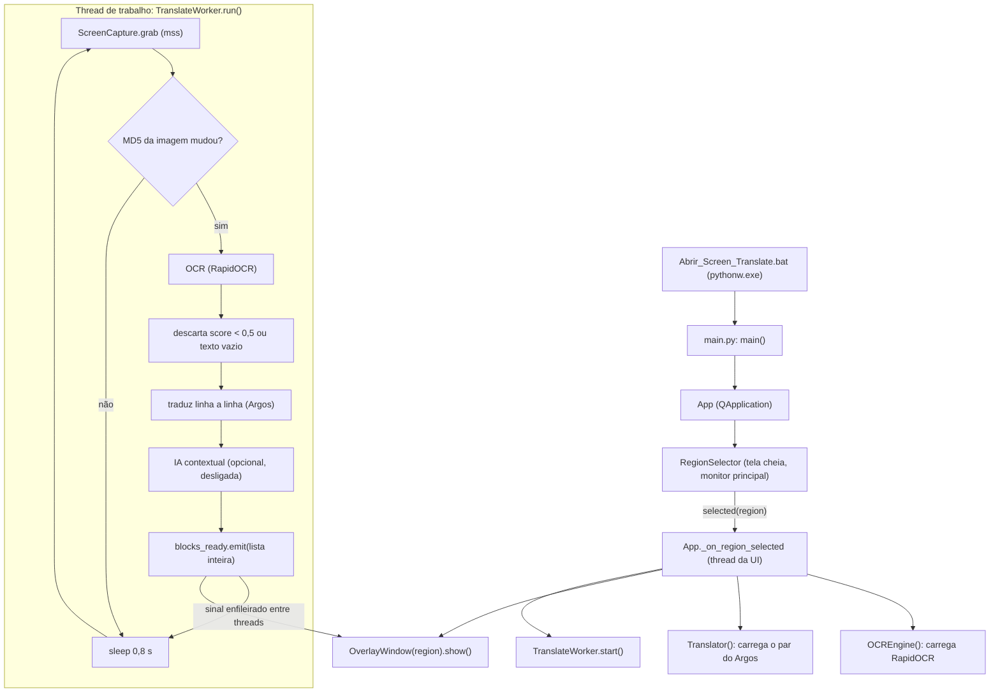

# ARQUITETURA ATUAL — o comportamento REAL do protótipo

> **Registro histórico da Fase 0.** Descreve o código do ZIP original, **antes** da Fase 1; as linhas citadas (`arquivo:linha`) valem para aquele código e este arquivo não é mais regenerado. O estado atual e as correções estão em [`LIMPEZA_PROJETO.md`](LIMPEZA_PROJETO.md).

> Fase 0 — gerado em 2026-10-05. Fonte: leitura integral do código e execução de partes dele (ver `AUDITORIA_PROJETO.md` §0 e §7). O README **não** foi usado como fonte de comportamento; onde ele diverge do código, vale o código. As referências `arquivo:linha` valem para o ZIP original (SHA-256 no Anexo A da auditoria).

## 1. Visão geral

- **Um processo Python** aberto por `pythonw.exe` (sem console) e **duas threads**: a da interface (loop do Qt) e uma `QThread` de trabalho (`TranslateWorker`).
- **Nove módulos planos** na raiz, importados pelo nome (`import config`), sem pacote, sem testes, sem logs.
- O fluxo existe só para **um** idioma de origem fixo (`SOURCE_LANG = 'en'`) e **uma** região fixa escolhida no início.

Em texto: `captura (mss)` → `MD5 da imagem inteira` → *(igual: dorme 0,8 s; diferente:)* `OCR` → `filtro de score` → `tradução por linha` → `(IA)` → `sinal` → `overlay`.

## 2. O fluxo desejado × o que existe

| # | Etapa desejada | Existe? | Onde | O que realmente acontece | Defeitos |
|---|---|---|---|---|---|
| 1 | Captura | Parcial | capture.py:26-28; worker.py:31,35 | `mss.grab` da região fixa, devolvendo BGRA. A região vem em coordenadas lógicas do Qt e é tratada como pixels. O `ScreenCapture` é criado em `__init__` (thread da UI) e usado em `run()` (QThread). | D35, D36, D37 |
| 2 | Mudança de tela | Só hash | worker.py:36-40 | MD5 de todos os bytes do quadro. Igual → ignora. Qualquer diferença → reprocessa na hora. Não distingue scroll de outra mudança. | D49, D31, D32 |
| 3 | OCR | Sim | ocr_engine.py:19-39 | `RapidOCR()` com os modelos padrão do wheel; descarta o alfa; transforma cada polígono em retângulo; devolve `bbox`, `text`, `score`. | D20, D47 |
| 4 | Detecção de idioma | Não | main.py:99 | `SOURCE_LANG` fixo vai direto para o `Translator`. | D28 |
| 5 | Agrupamento de blocos | Não | worker.py:50-72 | Cada linha do OCR vira um bloco. Só há o filtro `score < 0.5` ou texto vazio (worker.py:51). | D46, D26 |
| 6 | Tradução | Sim | translator.py:33-37; worker.py:62 | Argos, um par fixo, uma chamada por linha, síncrona dentro do laço de captura. | D13, D15, D48 |
| 7 | Cache | Não | — | Nenhum. Cada hash novo retraduz tudo. | D33 |
| 8 | Rastreamento | Não | — | Os blocos não têm id; não há associação entre quadros. | D34 |
| 9 | Estabilização | Não | worker.py:42 | O `sleep(0.8)` roda depois de cada leitura e não considera quando foi a última alteração. | D31, D32 |
| 10 | Overlay | Parcial | overlay.py:35-54; worker.py:74 | Uma emissão por quadro processado, substituindo a lista inteira. Caixa preta translúcida + texto branco, recortado se não couber. | D29, D42, D43, D44, D50 |

## 3. Threads, sinais e ciclo de vida

**Thread da UI**

1. `main()` cria `App()` (QApplication, main.py:79) e chama `app.start()`, que mostra o `RegionSelector` (tela cheia do **monitor principal**, main.py:29, opacidade 0,25) e entra em `exec_()`.
2. No `mouseReleaseEvent` a área é validada (≥ 10 px, main.py:54) e `selected.emit(region)` é chamado. Como emissor e receptor estão na mesma thread, o slot roda **antes** de `self.close()` (main.py:61-62).
3. O slot `_on_region_selected` (main.py:93-122) cria `OCREngine()` e `Translator()` — carga de modelos que leva segundos, **na thread da UI e com o seletor escuro ainda na tela** (D52) —, cria o `ContextRefiner` se ligado, mostra o `OverlayWindow` e inicia o `TranslateWorker`.
4. O sinal `blocks_ready` (lista) é conectado a `OverlayWindow.update_blocks` (main.py:119): entrega enfileirada, pois emissor e receptor estão em threads diferentes.

**Thread de trabalho** — `TranslateWorker.run()` (worker.py:33-44): capturar → MD5 → (se mudou) `_process_frame` → `sleep(interval)`. OCR, tradução e IA são **sequenciais** na mesma thread (D40). Nenhuma exceção é tratada (D16).

**Saída do programa.** ESC só é tratado pelo `RegionSelector` (main.py:64-66), que já foi fechado. Depois da seleção não existe mecanismo de saída: o overlay não trata teclas, `TranslateWorker.stop()` nunca é chamado (D12) e a mensagem do próprio código manda 'Feche a janela do overlay ou mate o processo para parar' (main.py:122) — o que contradiz a docstring e o GUIA (D02, D03).

## 4. Sistemas de coordenadas

| Onde | Sistema | Referência |
|---|---|---|
| Seleção (`RegionSelector`) | coordenadas lógicas do Qt, relativas ao monitor principal | main.py:29-30, 39-52 |
| Captura (`mss`) | o mesmo tuplo, tratado como pixels de tela | capture.py:19-26 |
| OCR | relativo ao recorte; o worker soma a origem da região | worker.py:54-60 |
| Overlay | janela na geometria da região; caixa = bbox − origem | overlay.py:18, 46-47 |

Em 100% de escala e no monitor principal os quatro coincidem (o teste do worker confirma a soma e o do overlay confirma a subtração). Em outras escalas e em monitores secundários nada é convertido (D35). O `mss` liga a consciência de DPI do processo ao ser instanciado (`SetProcessDpiAwareness(2)`, mss 9.0.1:159 e 10.2.0:256); a interação disso com o Qt não foi verificada em Windows.

## 5. Estruturas de dados

- Bloco do OCR: `{"bbox": (x1, y1, x2, y2) relativo, "text": str, "score": float}`.
- Bloco do overlay: `{"bbox": absoluto, "text": tradução}`.
- Não existem: id estável, idioma, orientação, confiança por idioma, linhas originais, ordem de leitura, polígono.

## 6. O que acontece hoje durante um scroll

1. O usuário rola; os pixels da região mudam.
2. No próximo ciclo (até 0,8 s de `sleep` + o tempo do processamento em curso) o worker captura o quadro novo; o hash é diferente.
3. `_process_frame` roda o OCR — medido em Linux/CPU: 1,25 a 1,9 s para um recorte de 900×220 px — e traduz linha a linha.
4. Só então `blocks_ready` é emitido. Até lá o overlay **continua mostrando a tradução antiga sobre o conteúdo novo** (D50).
5. Se o scroll continua, cada ciclo vê um hash novo e o trabalho se repete, inclusive sobre quadros intermediários que ninguém verá (D31, D49).
6. Como o overlay fica dentro da região e o `mss` captura janelas em camadas, a captura seguinte contém a tradução desenhada: o hash muda mesmo com a tela parada (D37 — inferido do código, a confirmar em Windows).

## 7. Falhas: o que o usuário vê hoje

| Situação | Resultado | Evidência |
|---|---|---|
| Pacote en→pt não instalado | `RuntimeError` no slot (main.py:98 → translator.py:27) → o processo aborta (rc=134 em Linux), sem diálogo | sonda D11 |
| OCR ou tradução lança exceção no worker | o processo inteiro aborta | sonda D16 |
| Dependência não importa (ex.: stanza/torch) | `ImportError` no carregamento de main.py (linhas 17-18), fora do `try/except` (linha 126): o app não abre e nada é exibido | sonda D17 |
| `.gguf` inexistente com a IA ligada | `ValueError` no slot (main.py:106): mesmo mecanismo da D11 | leitura do código |
| Tela sem texto | o OCR devolve lista vazia; o overlay é limpo | teste de caracterização |
| Quadro idêntico ao anterior | não reprocessa | teste de caracterização |

## 8. Da arquitetura atual para a arquitetura alvo

| Hoje | Destino (estrutura recomendada) | Fase |
|---|---|---|
| config.py | app/config/ (configuração tipada, validada, sem duplicações) | 1 e 2 |
| capture.py | app/capture/ (DPI, monitores, validação de região) | 3 |
| ocr_engine.py | app/ocr/ (interface `OCREngine` + backends; pré-processamento adaptativo) | 4 e 5 |
| — (não existe) | app/language/ (detecção de idioma por bloco) | 6 |
| — (não existe) | agrupamento semântico e ordem de leitura | 7 |
| translator.py | app/translation/ (interface `TranslationEngine`, lote) + app/cache/ | 8 |
| — (não existe) | app/tracking/ (id estável entre quadros) | 9 |
| — (não existe) | app/stabilization/ (mudança, scroll, máquina de estados, 1,5 s) | 10 |
| overlay.py | app/overlay/ (layout adaptativo, fundo branco, clique-através, sem roubar foco) | 11 e 12 |
| worker.py | app/workers/ (captura, OCR, idioma, tradução, overlay em filas) | 13 |
| context_ai.py | módulo opcional e isolado de IA contextual | 14 |
| main.py | app/main.py + app/ui/ | 1 e 13 |
| install_language_pack.py | app/diagnostics/ + gerenciador de modelos | 2 e 8 |
| *.bat | launcher mínimo + bootstrap em Python (pathlib/subprocess) com log | 2 |
