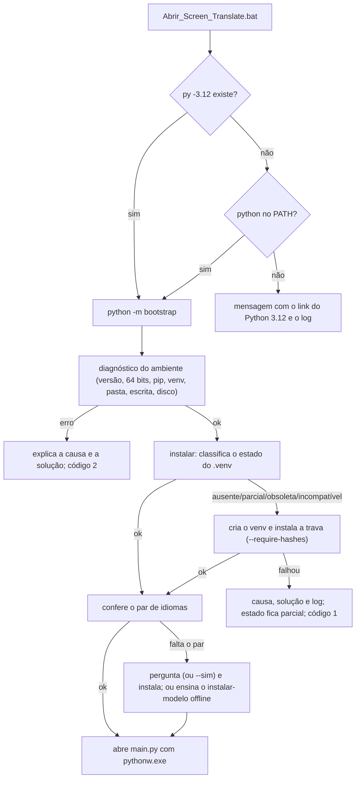

# FASE 2 — Base de execução confiável no Windows

> Gerado em 2026-10-15 por `tools/gerar_fase2.py` a partir dos dados curados, dos fixtures e do resultado real do pytest. **Nenhum teste desta fase foi executado em Windows** (a sandbox é Linux): o que depende do Windows está escrito, marcado `windows` e listado na seção 8 como pendente.

Documentos irmãos: [`AUDITORIA_PROJETO.md`](AUDITORIA_PROJETO.md), [`LIMPEZA_PROJETO.md`](LIMPEZA_PROJETO.md), [`MAPA_DEPENDENCIAS.md`](MAPA_DEPENDENCIAS.md), [`ARQUITETURA_ATUAL.md`](ARQUITETURA_ATUAL.md).

## 1. Objetivo e escopo

Dar ao programa uma instalação **previsível e diagnosticável**: um Python escolhido por evidência, versões travadas com hash, um launcher que não quebra com acento, espaço, `&` ou parênteses, um instalador em Python que explica cada falha e retoma o que parou, modo offline, logs em arquivo e atalho que só diz 'criado' se criou. A fase **não toca** captura, OCR, tradução, overlay nem worker.

## 2. Decisão: Python 3.12 de 64 bits

| Python | Requisitos diretos no Windows x64 (PyPI, semântica do pip) | Papel |
|---|---|---|
| 3.10 | todos instalam | instala, mas sem trava validada: só com `--sem-trava` |
| 3.11 | todos instalam | instala, mas sem trava validada: só com `--sem-trava` |
| 3.12 | todos instalam | **baseline**: o mais novo em que todos os requisitos diretos instalam; trava validada |
| 3.13 | NÃO instala: rapidocr-onnxruntime | recusado: rapidocr-onnxruntime exige Python < 3.13 (confirmado com o pip) |
| 3.14 | NÃO instala: rapidocr-onnxruntime | recusado: rapidocr-onnxruntime exige Python < 3.13 (confirmado com o pip) |

Por que não o 3.13 ou o 3.14 (que são mais novos): o pacote de OCR não instala neles, e o plano manda escolher por evidência, não por ser o mais novo. Por que não o 3.11: o 3.12 também instala tudo e é a versão que a trava cobre. A versão fica em `.python-version` e o bootstrap lê de lá.

**Trava verificada.** O `requirements.lock` fixa **75 pacotes** com hash. O `pip download --require-hashes` para `win_amd64`/`cp312` baixou os 75 wheels (340.8 MB) e conferiu cada hash (evidência em `tests/fixtures/verificacao_da_trava_fase2.json`). Entre a resolução da Fase 0 e a geração da trava (um dia) o PyPI mudou três versões (`filelock`, `pyqt5-sip`, `typer`): é a prova de que, sem trava, a instalação muda sozinha.

## 3. Plano da fase

| Ponto | Subtarefas | Arquivos | Testes | Critério de aprovação | Critério de reprovação |
|---|---|---|---|---|---|
| P1 Escolher e declarar o Python | comparar as versões 3.10 a 3.14 com os dados do PyPI e o pip; declarar a escolhida em .python-version; política de versão no bootstrap | .python-version, bootstrap/constantes.py, bootstrap/ambiente.py | unidade: política de versão e arquitetura · regressão: .python-version coerente com a trava | 3.12 x64 aceito; 3.13+, 32 bits e <3.10 recusados com a causa; 3.10/3.11 só com --sem-trava | Python errado aceito sem aviso |
| P2 Instalação reproduzível | gerar requirements.lock com versões fixas e hashes para Windows x64; instalar com --require-hashes; conferir os hashes baixando os wheels | requirements.lock, tools/gerar_trava.py, tests/fixtures/verificacao_da_trava_fase2.json | regressão: versões fixas, hashes, mesmos pacotes da Fase 0 · integração: hash errado é recusado pelo pip | 75 pacotes com hash e wheel para win_amd64/cp312; pip aceitou todos os hashes | pacote sem hash, sem wheel ou com versão solta |
| P3 Launcher mínimo e seguro | trocar os dois .bat por launchers de poucas linhas (ASCII, CRLF, sem blocos, com log, 'py -3.12'); arquivar os originais | Abrir_Screen_Translate.bat, Criar_Atalho_Desktop.bat, docs/legado/*.bat | regressão estática: ASCII, CRLF, sem %errorlevel% em bloco, sem >nul, %~dp0 entre aspas, rótulos usados | todos os testes estáticos do launcher passam | qualquer defeito de BAT reaparecer |
| P4 Diagnóstico com causa e solução | verificar sistema, Python, py -0p, pip, venv, caminho, escrita, disco, internet, arquivos, ambiente virtual, dependências e modelos | bootstrap/diagnostico.py, bootstrap/ambiente.py | unidade: cada verificação em ok/aviso/erro/pulado · integração: python -m bootstrap em pastas difíceis | cada erro traz causa e solução; relatório em texto e JSON | erro sem solução ou diagnóstico que mente |
| P5 Instalador com estado | criar o .venv, instalar a trava, validar as importações e registrar o estado; distinguir ausente, parcial, incompatível, obsoleta e ok | bootstrap/instalador.py, bootstrap/estado.py | unidade: máquina de estados com ferramentas falsas · integração: venv e pip de verdade com pacotes falsos | retoma o interrompido, atualiza, reinstala e não repete o que já está pronto | instalação que recomeça do zero ou que diz 'pronto' sem estar |
| P6 Modo offline e modelos | instalar com --no-index e uma pasta de wheels; baixar a pasta para uso offline; instalar .argosmodel já baixado; conferir os modelos do OCR e da tradução | bootstrap/instalador.py, bootstrap/modelos.py | integração: instalação offline real; unidade: modelos com bibliotecas falsas | offline funciona e o modelo ausente aparece com as duas saídas (com e sem internet) | tentar a internet no modo offline |
| P7 Registros (logs) | um módulo de log em arquivo UTF-8 para o app e o bootstrap; redirecionar stdout/stderr sob pythonw; faulthandler | registro.py, main.py, bootstrap/cli.py | unidade e integração: pasta difícil, fallback, limpeza, pythonw simulado, queda do processo | todo erro deixa rastro em logs/ | erro sem registro |
| P8 Atalho e erro de importação | criar o atalho em Python (Área de Trabalho real, PowerShell por variáveis de ambiente); main.py explica falha de import numa caixa de mensagem | bootstrap/atalho.py, bootstrap/lancador.py, main.py | unidade: candidatos de Desktop, script do PowerShell, sucesso só se o .lnk aparece · falha: import quebrado | o atalho só é dado como criado se o arquivo existe | sucesso falso |
| P9 Lint, tipos e regressão | ruff e mypy no bootstrap e no registro; suíte das Fases 0 e 1; manifesto da Fase 2 encadeado com o da Fase 1 | ruff.toml, mypy.ini, tests/phase0..2 | regressão: suíte inteira; manifesto; módulos do aplicativo inalterados | 0 falhas, 0 alertas | qualquer falha ou módulo do aplicativo alterado |

**Riscos.** (1) Parecer pronto sem ter rodado em Windows: por isso a seção 8. (2) Lock desatualizada: o teste compara com a resolução da Fase 0 e com o download verificado. (3) Instalação que recomeça do zero ou diz 'pronto' sem estar: máquina de estados testada com ferramentas falsas e com venv de verdade. (4) Launcher quebrar com caracteres da pasta: testes estáticos e instalações reais em quatro pastas difíceis. **Desempenho:** não se aplica (nenhum caminho de captura, OCR ou tradução mudou).

## 4. Arquitetura do bootstrap

| Arquivo | Papel |
|---|---|
| `bootstrap/constantes.py` | versões, nomes de arquivos, lista de módulos que o app importa, limites, códigos de saída |
| `bootstrap/ambiente.py` | sondas: Python, py -0p, caminho, escrita, disco, internet, pip, venv, importações |
| `bootstrap/diagnostico.py` | as 14 verificações, relatório em texto e JSON, separação entre erro do ambiente e erro da instalação |
| `bootstrap/estado.py` | estado da instalação em JSON atômico; classifica ausente, parcial, incompatível, obsoleta, ok |
| `bootstrap/instalador.py` | cria o .venv, instala a trava, valida, registra; reinstala, atualiza, offline, baixar-offline |
| `bootstrap/modelos.py` | modelos do OCR (dentro do pacote pip), pacotes de idioma do Argos, instalação de .argosmodel |
| `bootstrap/atalho.py` | Área de Trabalho real e atalho .lnk via PowerShell com variáveis de ambiente |
| `bootstrap/lancador.py` | abre o app com pythonw.exe no Windows e avisa se ele morrer ao abrir |
| `bootstrap/cli.py` | comandos: iniciar, diagnostico, instalar, instalar-modelo, baixar-offline, atalho |
| `registro.py` | log em arquivo UTF-8 (app e bootstrap), stdout/stderr sob pythonw, faulthandler, limpeza dos antigos |



| Situação do .venv | Quando | O que o instalador faz |
|---|---|---|
| ausente | não há .venv, ou há pasta sem o python | apaga o resto, cria o venv, instala, valida |
| parcial | sem registro, JSON corrompido ou instalação parada no meio (etapa diferente de 'concluida') | mantém o venv e roda o pip de novo (idempotente) |
| incompatível | o venv foi criado por outra versão do Python | apaga e recria |
| obsoleta | a trava (SHA-256) ou o modo (trava/sem trava) mudou | mantém o venv e roda o pip (atualiza) |
| ok | etapa 'concluida', mesma trava, mesmo Python | não faz nada (segundo lançamento) |

Códigos de saída: **0** ok · **1** a operação falhou · **2** ambiente não suportado ou uso incorreto. Sempre que não é 0 o bootstrap imprime onde está o registro completo.

## 5. Cobertura dos cenários pedidos pelo plano

| Cenário | Testes (resultado) |
|---|---|
| Python inexistente | `test_launcher_avisa_quando_o_python_nao_existe` (passou)<br>`test_launcher_tenta_py_depois_python_do_path` (passou)<br>`test_pip_ausente_e_erro_com_solucao` (passou) |
| Python errado (versão) | `test_politica_de_versao_do_python` (passou)<br>`test_python_errado_nao_cria_nada` (passou)<br>`test_python_incorreto_real_nao_cria_o_venv` (passou)<br>`test_iniciar_com_python_errado_nao_instala_nem_abre` (passou) |
| Python correto | `test_politica_de_versao_do_python` (passou)<br>`test_instalacao_cria_venv_roda_pip_e_registra_o_estado` (passou)<br>`test_python_312_pelo_launcher_py` (Windows: ignorado) |
| Arquitetura x64 (32 bits recusado) | `test_politica_de_versao_do_python` (passou)<br>`test_python_errado_nao_cria_nada` (passou) |
| Windows | `test_lista_de_pythons_so_existe_no_windows` (passou)<br>`test_diagnostico_do_python` (passou)<br>`test_diagnostico_real_no_windows` (Windows: ignorado)<br>`test_launcher_bat_roda_o_diagnostico_e_grava_o_log` (Windows: ignorado) |
| Caminho com espaço | `test_caminhos_dificeis_nao_sao_problema` (passou)<br>`test_instalacao_offline_real_em_pasta_dificil` (passou)<br>`test_python_m_bootstrap_diagnostico_em_pasta_dificil` (passou) |
| Caminho com acento | `test_avaliacao_do_caminho` (passou)<br>`test_instalacao_offline_real_em_pasta_dificil` (passou)<br>`test_launcher_bat_em_pasta_com_acento_espaco_e_comercial` (Windows: ignorado) |
| Caminho Unicode (japonês e coreano) | `test_instalacao_offline_real_em_pasta_dificil` (passou)<br>`test_log_em_pasta_dificil_grava_utf8` (passou)<br>`test_python_m_bootstrap_diagnostico_em_pasta_dificil` (passou) |
| Pasta em C: | `test_unidade_do_caminho` (passou)<br>`test_avaliacao_do_caminho` (passou) |
| Pasta em D: | `test_unidade_do_caminho` (passou)<br>`test_diagnostico_em_outra_unidade_se_existir` (Windows: ignorado) |
| Pasta com parênteses | `test_avaliacao_do_caminho` (passou)<br>`test_caracteristicas_marcam_cada_tipo_de_caractere` (passou)<br>`test_instalacao_offline_real_em_pasta_dificil` (passou) |
| Pasta com '&' | `test_avaliacao_do_caminho` (passou)<br>`test_launchers_citam_caminhos_entre_aspas` (passou)<br>`test_atalho_criado_com_caminhos_dificeis_passa_tudo_por_variaveis_de_ambiente` (passou) |
| Instalação parcialmente concluída | `test_instalacao_parcial_real_termina_na_segunda_tentativa` (passou)<br>`test_pasta_venv_pela_metade_sem_python_e_recriada` (passou)<br>`test_estado_parcial_sem_registro_com_json_corrompido_e_etapa_incompleta` (passou) |
| Instalação interrompida | `test_instalacao_interrompida_continua_de_onde_parou` (passou)<br>`test_instalar_interrompido_diz_como_continuar` (passou) |
| Segundo lançamento | `test_segundo_lancamento_nao_faz_nada` (passou)<br>`test_segundo_lancamento_real_nao_reinstala` (passou) |
| Reinstalação | `test_reinstalacao_recria_o_venv` (passou)<br>`test_reinstalacao_real_recria_o_ambiente` (passou) |
| Atualização | `test_atualizacao_quando_a_trava_muda_roda_o_pip_sem_recriar_o_venv` (passou)<br>`test_atualizacao_real_quando_a_trava_muda` (passou)<br>`test_venv_criado_por_outra_versao_do_python_e_recriado` (passou) |
| Internet indisponível | `test_sem_internet_no_modo_online_e_erro_que_aponta_o_modo_offline` (passou)<br>`test_sem_internet_no_modo_online_nao_cria_o_venv` (passou)<br>`test_internet_indisponivel` (passou)<br>`test_modo_offline_nao_consulta_a_internet_e_usa_no_index` (passou) |
| Modelo ausente | `test_modelo_de_traducao_ausente_mostra_os_dois_caminhos` (passou)<br>`test_modelos_do_ocr_presentes_e_ausentes` (passou)<br>`test_sem_o_pacote_de_idioma_e_sem_resposta_para_com_instrucoes` (passou)<br>`test_diagnostico_de_modelos_ausente_e_depois_instalado` (passou) |
| Dependência parcialmente instalada | `test_dependencia_parcialmente_instalada_e_detectada_pela_importacao` (passou)<br>`test_dependencia_quebrada_real_e_apontada_pelo_nome` (passou)<br>`test_dependencias_quebradas_citam_o_modulo_e_a_solucao` (passou) |
| pip ausente e venv ausente | `test_pip_ausente_e_erro_com_solucao` (passou)<br>`test_modulo_venv_ausente_e_erro_com_solucao` (passou)<br>`test_modulo_venv_ausente` (passou) |
| Permissão insuficiente | `test_sem_permissao_de_escrita_e_erro_claro` (passou)<br>`test_pasta_sem_escrita_e_erro` (passou)<br>`test_nao_pode_escrever_em_pasta_somente_leitura` (ignorado) |
| Hash errado na trava | `test_hash_errado_na_trava_e_recusado_pelo_pip` (passou) |

'Windows: ignorado' significa **escrito e ainda não executado**: roda no seu computador com `python -m pytest tests -m windows -v`.

## 6. Defeitos corrigidos nesta fase (13)

| ID | Gravidade | Problema | Como foi corrigido | Teste de regressão |
|---|---|---|---|---|
| D09 | Crítica | BAT usa o Python mais novo; em 3.13/3.14 o pip não instala rapidocr-onnxruntime | o launcher chama 'py -3.12' (nunca o 'py' sem versão) e o bootstrap recusa Python errado com a causa | `tests/phase2/test_08_launcher_bat.py::test_launcher_escolhe_python_3_12_explicitamente` |
| D17 | Crítica | Falha de import de dependência acontece fora do handler: o app não abre e não avisa | main.py captura a falha de import quando é o programa, grava no log e mostra a causa numa caixa de mensagem | `tests/phase2/test_09_registro_e_logs.py::test_falha_de_import_mostra_dialogo_e_registra_no_log` |
| D01 | Alta | BAT: %errorlevel% dentro de bloco; o fallback para 'python' nunca funciona | o launcher novo não usa blocos nem lê %errorlevel% dentro deles (só 'if errorlevel' e 'set CODIGO=%errorlevel%' fora de bloco) | `tests/phase2/test_08_launcher_bat.py::test_launcher_nao_le_errorlevel_dentro_de_bloco` |
| D05 | Alta | BAT: 'verificação de componentes' superficial (import PyQt5, ..., argostranslate) | a checagem superficial do BAT virou o diagnóstico em Python, que importa os 8 módulos que o código realmente usa | `tests/phase2/test_03_diagnostico.py::test_diagnostico_cobre_os_imports_reais_do_codigo` |
| D04 | Média | Os dois BAT usam fim de linha LF (sem CRLF) | os dois launchers foram reescritos com fim de linha CRLF | `tests/phase2/test_08_launcher_bat.py::test_launchers_usam_fim_de_linha_crlf` |
| D06 | Média | requirements.txt sem versões fixas nem arquivo de trava | requirements.lock com versões fixas e hashes (75 pacotes), usado por padrão pelo instalador | `tests/phase2/test_10_trava_e_requisitos.py::test_trava_tem_versoes_fixas_e_hashes` |
| D07 | Média | Versão do Python não declarada em nenhum arquivo | .python-version declara o Python 3.12, lido pelo bootstrap e coerente com a trava | `tests/phase2/test_10_trava_e_requisitos.py::test_versao_do_python_esta_declarada_e_coerente` |
| D22 | Média | Atalho: mostra sucesso sem checar o PowerShell; Desktop fixo (OneDrive) | o atalho é criado em Python: acha a Área de Trabalho de verdade (OneDrive) e só diz que criou se o .lnk apareceu | `tests/phase2/test_07_atalho_e_lancador.py::test_atalho_so_e_sucesso_se_o_arquivo_aparece` |
| D24 | Média | BAT não grava log | o launcher e o bootstrap gravam logs/launcher.log e logs/bootstrap-*.log | `tests/phase2/test_08_launcher_bat.py::test_launcher_grava_log_em_arquivo` |
| D38 | Média | Sem logging; só print() (some com pythonw.exe) | registro.py configura logs em arquivo (inclusive sob pythonw.exe) e main.py o usa | `tests/phase2/test_09_registro_e_logs.py::test_aplicativo_configura_registro_em_arquivo` |
| D51 | Média | BAT esconde erros (>nul 2>&1) e diagnostica errado | o launcher não descarta nenhuma saída (nada de >nul) | `tests/phase2/test_08_launcher_bat.py::test_launcher_nao_descarta_a_saida_de_erro` |
| D21 | Baixa | BAT com caractere não-ASCII (linha 50) e dependente de chcp 65001 | os launchers são só ASCII e não usam chcp | `tests/phase2/test_08_launcher_bat.py::test_launchers_sao_somente_ascii` |
| D23 | Baixa | Atalho: '%~dp0' dentro de aspas simples do PowerShell | o script do PowerShell é fixo e recebe os caminhos por variáveis de ambiente | `tests/phase2/test_07_atalho_e_lancador.py::test_script_do_atalho_nao_tem_caminhos_embutidos` |

**Achados durante a fase** (fora da numeração D01–D52):

| ID | O que era | Como apareceu e o que foi feito |
|---|---|---|
| A02 | o launcher fazia 'echo ... %~dp0' sem aspas: numa pasta com '&' o cmd.exe corta o comando no '&' | achado por test_launchers_citam_caminhos_entre_aspas e corrigido (aspas em volta do %~dp0) |
| A03 | 'python -m bootstrap --help' mostrava só a ajuda do comando 'iniciar', sem a lista de comandos | achado por test_bootstrap_roda_em_processo_limpo_e_mostra_ajuda e corrigido |
| A04 | o analisador de BAT tratava a URL 'www.python.org' como um arquivo '.py' | achado ao rodar os testes antigos com o launcher novo; a expressão regular agora exige o fim da extensão |
| A05 | dois arquivos de teste com o mesmo nome em pastas diferentes quebram a coleta do pytest | o da Fase 2 foi renomeado; regra: nomes de arquivo de teste únicos entre as fases |

## 7. Defeitos ainda em aberto (27)

| Fase | Qtde | Defeitos |
|---|---|---|
| 2 | 1 | D08 |
| 3 | 2 | D35, D36 |
| 4 | 2 | D20, D47 |
| 6 | 1 | D28 |
| 7 | 1 | D46 |
| 8 | 4 | D13, D15, D33, D48 |
| 9 | 1 | D34 |
| 10 | 4 | D31, D32, D49, D50 |
| 11 | 3 | D29, D30, D44 |
| 12 | 4 | D02, D37, D42, D43 |
| 13 | 4 | D12, D16, D40, D52 |

O D08 (`llama-cpp-python` sem wheel para Windows) tinha a Fase 2 entre as fases de correção, mas é um fato do PyPI: segue aberto, como `xfail` estrito, até a Fase 14 decidir a IA contextual.

## 8. O que NÃO foi verificado (pendente de Windows)

- O launcher .bat rodando no cmd.exe de verdade (CRLF, rótulos, %~dp0 com '&', 'py -3.12', 'pause').
- O launcher 'py' e a saída real de 'py -0p' (o parser foi testado com os dois formatos conhecidos, não com a sua máquina).
- O atalho .lnk: PowerShell, WScript.Shell e a chamada SHGetKnownFolderPath para achar a Área de Trabalho (inclusive no OneDrive).
- pythonw.exe e o destacamento do processo (DETACHED_PROCESS) ao abrir o programa.
- Instalação real da trava (75 pacotes, 341 MB): só foi verificado que o pip baixa os wheels e aceita os hashes, não que a instalação e os imports funcionam em Windows.
- Argos Translate, CTranslate2 e torch carregando em Windows; CTranslate2 lendo modelos de uma pasta de usuário com acento.
- faulthandler registrando a queda do processo em Windows.

**Como confirmar no seu Windows** (Python 3.12 de 64 bits instalado):

```powershell
py -3.12 -m venv .venv-testes
.venv-testes\Scripts\python -m pip install -r tests\requirements-test.txt
.venv-testes\Scripts\python -m pytest tests -q -m windows -v      # os testes que só rodam no Windows
.venv-testes\Scripts\python -m pytest tests -q                    # a suíte inteira
Abrir_Screen_Translate.bat --diagnostico                            # relatório do seu ambiente
python -m bootstrap diagnostico --json relatorio_windows.json       # envie este arquivo para calibrar a Fase 3
```

## 9. Resultado dos testes

**571 testes na suíte completa:** 527 passaram · 27 defeitos conhecidos (xfail estrito) · 17 ignorados · 0 falharam.

| Fase | Arquivo de teste | Passaram | Defeitos (xfail) | Ignorados | Falharam |
|---|---|---|---|---|---|
| phase2 | test_00_manifesto_da_fase2.py | 14 | 0 | 0 | 0 |
| phase2 | test_02_ambiente.py | 74 | 0 | 1 | 0 |
| phase2 | test_03_diagnostico.py | 36 | 0 | 0 | 0 |
| phase2 | test_04_estado_e_instalador.py | 35 | 0 | 0 | 0 |
| phase2 | test_05_instalacao_real_offline.py | 14 | 0 | 0 | 0 |
| phase2 | test_06_modelos.py | 25 | 0 | 0 | 0 |
| phase2 | test_07_atalho_e_lancador.py | 17 | 0 | 0 | 0 |
| phase2 | test_08_launcher_bat.py | 24 | 0 | 0 | 0 |
| phase2 | test_09_registro_e_logs.py | 14 | 0 | 0 | 0 |
| phase2 | test_10_trava_e_requisitos.py | 15 | 0 | 0 | 0 |
| phase2 | test_11_cli.py | 46 | 0 | 0 | 0 |
| phase2 | test_12_windows_real.py | 0 | 0 | 9 | 0 |
| phase2 | test_13_defeitos_corrigidos.py | 5 | 0 | 0 | 0 |

**Ignorados e por quê** (nunca contam como aprovados): 9× só roda em Windows: não foi executado na sandbox de Linux (rode no seu computador); 3× importação real não exercitável neste ambiente: falta o pacote 'argostranslate'; 2× a Fase 2 substituiu este teste por tests/phase2/test_00_manifesto_da_fase2.py; 1× a Fase 1 substituiu este teste por tests/phase1/test_01_manifesto_e_inventario.py; 1× importação real não exercitável neste ambiente: falta o pacote 'llama_cpp'; 1× o usuário root ignora permissões de pasta.

**Lint e tipos:** `ruff check .` e `mypy` (21 arquivos: aplicativo, `registro.py` e `bootstrap/`) — ruff: passou; mypy: passou.

## 10. Critérios e veredito

| Critério (verificável em Linux) | Resultado |
|---|---|
| Suíte completa sem falhas (um XPASS estrito aparece como falha) | atendido |
| `ruff` e `mypy` sem alertas | atendido |
| Todos os cenários pedidos pelo plano têm teste que passou (exceto os marcados Windows) | atendido |
| Os 13 defeitos têm teste de regressão e nenhum marcador xfail | atendido |
| A trava tem versões fixas e hashes, e o pip aceitou todos os wheels | atendido |
| Instalação real offline em quatro pastas difíceis (espaço, acento, '&', parênteses, japonês, coreano) | atendido |
| Manifesto da Fase 2 bate e os módulos do aplicativo ficaram idênticos | atendido |
| Launcher: ASCII, CRLF, sem blocos, com log, 'py -3.12', %~dp0 entre aspas | atendido |

**Veredito da Fase 2 nos critérios verificáveis em Linux: APROVADA** — 8 de 8 atendidos.

**Condição pendente:** 9 testes escritos para Windows (`-m windows`) ainda não foram executados. A fase só pode ser dada como confirmada para o seu ambiente quando eles passarem na sua máquina.

## 11. Próxima fase

**Fase 3 — Captura de tela e coordenadas** (DPI, vários monitores, validação de região, mss na thread certa: D35, D36 e parte da D37). Precisa de Windows de verdade: escala do sistema, monitores e o comportamento do GDI não existem na sandbox.
