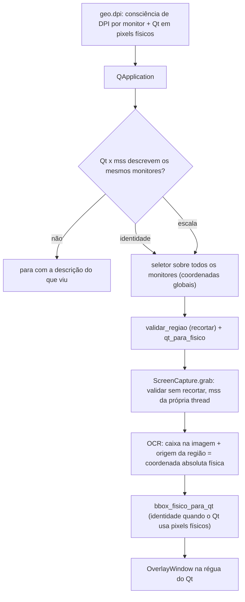

# FASE 3 — Captura de tela e coordenadas

> Gerado em 2026-10-17 por `tools/gerar_fase3.py` a partir dos dados curados, dos fixtures e do resultado real do pytest. **Nenhum teste desta fase foi executado em Windows** (a sandbox é Linux): o que depende do Windows está escrito, marcado `windows` e listado na seção 9 como pendente. A captura real foi testada num servidor X virtual (Xvfb), com o Qt e o mss de verdade.
> **Registro histórico da Fase 3** (entrega de 18/10/2026). O relato de campo do usuário (versão da Fase 2) e as correções que dele saíram estão em [`CAMPO_FASE3_1.md`](CAMPO_FASE3_1.md); lá também mudou a proposta da próxima fase (agrupar as linhas em balões antes do OCR por idioma).


Documentos irmãos: [`FASE2_AMBIENTE.md`](FASE2_AMBIENTE.md), [`AUDITORIA_PROJETO.md`](AUDITORIA_PROJETO.md), [`ARQUITETURA_ATUAL.md`](ARQUITETURA_ATUAL.md).

## 1. Objetivo e escopo

Garantir que **a coordenada do OCR, a da tela e a do overlay sejam a mesma**, sem deslocamento perceptível, em 1280x720, 1920x1080, 2560x1440 e 3840x2160, com a escala do Windows de 100 a 200 por cento, com um ou vários monitores (inclusive com escalas diferentes e coordenadas negativas). A fase **não toca** o OCR, a tradução, a IA, o desenho do overlay nem os launchers: o D37 (o overlay entrar na própria captura) fica para a Fase 12.

## 2. O que havia e a evidência

O seletor entregava coordenadas do **Qt**, o `mss` capturava em **pixels físicos** e nada conferia se as duas réguas eram a mesma. Só funcionava por coincidência (Qt sem escala, um monitor com a origem em (0, 0)); o seletor cobria apenas o monitor principal; o objeto do `mss` nascia na thread da interface e era usado na do worker. O que o código do `mss` faz em cada versão (lido dos wheels do PyPI, `tools/snapshot_mss_versoes.py`):

| mss | handles por thread | contextos no objeto | define o DPI ao nascer | CAPTUREBLT | monitores com is_primary | mss.MSS no topo | mss.mss obsoleto |
|---|---|---|---|---|---|---|---|
| 9.0.1 | sim | não | sim | sim | não | não | não |
| 9.0.2 | sim | não | sim | sim | não | não | não |
| 10.0.0 | sim | não | sim | sim | não | não | não |
| 10.1.0 | sim | não | sim | sim | não | não | não |
| 10.2.0 | não | sim | sim | sim | sim | sim | sim |

Leitura: (1) o D36 só quebra de verdade nas versões 9.0.1 a 10.1.0, que o `requirements.txt` ainda aceita; a trava usa a 10.2.0, que guarda os contextos no objeto. A correção (um objeto por thread) vale para todas. (2) Toda versão mexe na consciência de DPI do processo ao nascer, então a nossa configuração precisa vir **antes**. (3) `mss.mss()` está obsoleto exatamente na versão da trava. (4) `CAPTUREBLT` aparece em todas: o D37 segue aberto. (5) Só a 10.2 informa o monitor principal; nas outras o principal é o que tem a origem em (0, 0).

**O que a escala do Qt faz de verdade** (Qt real, plugin offscreen, tela de 800x600): com `QT_SCALE_FACTOR=1.5` e a escala ligada o Qt informa 533x400 e razão 1,5; depois de `geo.dpi.configurar_dpi_antes_do_qt()` informa 800x600 e razão 1,0, mesmo com a variável no ambiente (`test_qt_real_com_escala_ligada_e_reconhecido_e_convertido`: passou; `test_qt_real_configurado_volta_para_pixels_fisicos_mesmo_com_escala_no_ambiente`: passou).

## 3. Decisão

| Alternativa | Avaliação |
|---|---|
| A. Forçar o Qt a pixels físicos e conferir (ESCOLHIDA) | uma régua só: seleção, captura, OCR e overlay no mesmo pixel; sem conversão no caminho normal; a conferência recusa o que não bate |
| B. Deixar o Qt em pixels lógicos e converter sempre | implementada como plano B (EspacoDeCoordenadas) e usada só quando a conferência detecta escala; é o caminho menos exercitado no Windows |
| C. Confiar nos padrões do Qt e do Windows | rejeitada: com QT_SCALE_FACTOR=1.5 o Qt fala em 533x400 enquanto o mss captura 800x600 (teste com o Qt real), e o usuário pode ter essa variável no ambiente |

Por isso o programa liga a consciência de DPI por monitor, desliga a escala do Qt e **confere** (Qt x mss) antes de abrir: se os monitores não baterem ele para com a descrição do que viu, em vez de desenhar o overlay no lugar errado.

## 4. Plano da fase

| Ponto | Subtarefas | Arquivos | Testes | Critério de aprovação | Critério de reprovação |
|---|---|---|---|---|---|
| P1 Medir antes de mexer | separar os espaços de coordenadas (Qt lógico x captura física), reler o código do mss por versão e provar com o Qt de verdade o que a escala faz | tools/snapshot_mss_versoes.py, tests/fixtures/mss_por_versao.json | evidência: handles por thread, DPI no construtor, CAPTUREBLT, is_primary, API obsoleta, por versão | cada afirmação sobre o mss tem uma linha no fixture | afirmar algo do mss sem evidência |
| P2 Geometria pura | retângulos, monitores, área de trabalho virtual (origem negativa, buracos, espelhamento) e validação de região | geo/geometria.py | unidade e propriedades (hypothesis): interseção, cantos, união de áreas, cobertura, recorte idempotente | tela inteira, pixel único, bordas, fora da tela, vazia e mínima se comportam como especificado | região inválida aceita ou válida recusada |
| P3 Conversão lógico <-> físico | converter pontos, retângulos e caixas do OCR por monitor, cada um com a sua escala; bordas exclusivas e vizinhos sem fresta | geo/geometria.py (EspacoDeCoordenadas) | matriz: 4 resoluções x 5 escalas; vários monitores com escalas diferentes; propriedades | ida e volta com erro de até 1 pixel; deslocamento em relação à escala nominal menor que 1 pixel físico | deriva visível |
| P4 DPI e conferência Qt x mss | processo por monitor (v2) antes do Qt; Qt em pixels físicos; reconhecer identidade, escala ou incoerência; recusar o incoerente | geo/dpi.py, geo/monitores.py | API do Windows falsa; Qt real em processo limpo com e sem escala forçada no ambiente | o Qt volta a pixels físicos mesmo com QT_SCALE_FACTOR; layouts reconhecidos em 3 modos | escala do ambiente do usuário vazar para o app |
| P5 Captura nova | um objeto do mss por thread (D36), região validada e nunca recortada em silêncio, API atual do mss, releitura dos monitores a cada 5 s | capture.py, worker.py | mss sintético sobre desktop gerado por pixel; threads; plugar, desplugar e trocar resolução; falhas do mss | o recorte devolvido é idêntico, pixel a pixel, ao pedido em 20 combinações de layout e resolução | pixel diferente do pedido |
| P6 Seletor e aplicativo | seletor sobre todos os monitores (coordenadas negativas), DPI antes do QApplication, monitores conferidos, região validada, convertida e encaminhada | main.py | seletor com telas falsas; App com Qt real offscreen; processo limpo com escala no ambiente | seleção -> worker (físico) e overlay (Qt) corretos em identidade e com escala | região em régua errada |
| P7 Diagnóstico para o Windows | mostrar no relatório o que o Qt e o mss enxergam (monitores, escala, DPI), para calibrar a fase com dados reais | bootstrap/telas.py, bootstrap/diagnostico.py | o script roda de verdade (Qt offscreen) e o diagnóstico classifica ok, aviso e erro | a linha 'monitores' aparece no relatório | relatório sem dados de tela |
| P8 Cadeia inteira e captura real | OCR = tela = overlay: main.py de verdade + captura real + OCR por cor + overlay renderizado; e Xvfb + Qt xcb + mss real, sem fakes | tests/phase3/test_06, test_08 | 180 cadeias, 20 renderizações do overlay, 6 testes com X virtual | bloco físico idêntico ao marcador; overlay até 1 pixel do original; janela Qt no pixel certo da captura real | qualquer deslocamento maior que 1 pixel |
| P9 Teste de mutação, lint e regressão | 16 defeitos plantados, um por vez, numa cópia; ruff, mypy e a suíte das Fases 0 a 2; manifesto encadeado | tools/mutacoes_fase3.py, tests/fixtures/mutacoes_fase3.json | mutação, lint, tipos, manifesto | 16 de 16 defeitos pegos; 0 falhas; 0 alertas | um defeito plantado que a suíte não pega |

**Riscos.** (1) Confundir 'passou no simulado' com 'funciona no Windows': por isso a seção 9. (2) Teste que não protege nada: por isso a mutação (seção 7). (3) Custo da releitura de monitores: medida só com mss falso (ver seção 9). **Desempenho:** a validação de uma região leva menos de 1 ms (`test_o_tempo_de_validacao_e_desprezivel_perto_do_intervalo_de_captura`), contra um intervalo de captura de 1,5 s.

## 5. Arquitetura

| Arquivo | Papel |
|---|---|
| `geo/geometria.py` | retângulos, monitores, área de trabalho, validação, reposicionamento e conversão lógico <-> físico (lógica pura) |
| `geo/monitores.py` | monitores a partir do mss e do Qt; reconhece identidade, escala ou incoerência; recusa o incoerente |
| `geo/dpi.py` | consciência de DPI do processo (v2, por monitor, do sistema) e Qt em pixels físicos, antes do QApplication |
| `capture.py` | ScreenCapture: um mss por thread, região validada e nunca recortada em silêncio, API atual do mss, releitura a cada 5 s |
| `worker.py` | o ScreenCapture nasce dentro de run(), na thread que captura |
| `main.py` | seletor sobre todos os monitores; DPI antes do Qt; monitores conferidos; região validada, convertida e encaminhada |
| `bootstrap/telas.py` | o que o Qt e o mss enxergam dos monitores, para o relatório do diagnóstico |



## 6. Cobertura dos cenários pedidos

| Cenário | Testes (resultado) |
|---|---|
| Conversão de coordenadas (lógico e físico) | `test_cantos_da_tela_viram_cantos_da_tela` (passou)<br>`test_ponto_em_ponto_flutuante_faz_ida_e_volta_exata` (passou)<br>`test_retangulos_inteiros_cabem_na_tela_e_tem_o_tamanho_certo` (passou)<br>`test_ida_e_volta_de_retangulo_erra_no_maximo_um_pixel_logico_e_dois_fisicos` (passou)<br>`test_retangulos_vizinhos_continuam_vizinhos_sem_fresta_nem_sobreposicao` (passou) |
| DPI de 100 a 200 por cento | `test_tamanho_logico_bate_com_o_que_o_windows_reporta` (passou)<br>`test_a_razao_do_monitor_nao_se_afasta_da_escala_nominal` (passou)<br>`test_deslocamento_em_relacao_a_escala_nominal_fica_abaixo_de_um_pixel_fisico` (passou)<br>`test_cadeia_completa_em_todas_as_escalas_e_resolucoes` (passou) |
| Configuração do DPI do processo e do Qt | `test_dpi_por_monitor_v2_quando_o_windows_aceita` (passou)<br>`test_dpi_cai_para_o_shcore_quando_o_contexto_v2_nao_existe` (passou)<br>`test_dpi_tudo_falhando_devolve_o_relato_completo_sem_levantar_excecao` (passou)<br>`test_qt_real_com_escala_ligada_e_reconhecido_e_convertido` (passou)<br>`test_qt_real_configurado_volta_para_pixels_fisicos_mesmo_com_escala_no_ambiente` (passou)<br>`test_o_dpi_e_configurado_antes_de_criar_o_qapplication` (passou)<br>`test_app_inicia_em_pixels_fisicos_mesmo_com_escala_do_qt_no_ambiente` (passou) |
| Múltiplos monitores, principal e secundário, escalas diferentes | `test_cada_monitor_usa_a_propria_escala` (passou)<br>`test_tres_monitores_com_escalas_100_150_e_200` (passou)<br>`test_monitor_acima_do_principal_tem_y_negativo_nos_dois_espacos` (passou)<br>`test_escalas_diferentes_por_monitor_geram_um_aviso_por_monitor_escalado` (passou)<br>`test_tres_monitores_identicos_lado_a_lado_sao_pareados_pela_posicao` (passou)<br>`test_seletor_cobre_todos_os_monitores` (passou) |
| Captura da tela inteira | `test_captura_devolve_exatamente_os_pixels_pedidos_em_cada_monitor` (passou)<br>`test_tela_inteira_em_4k_chega_inteira` (passou) |
| Captura de região, região pequena e região junto da borda | `test_captura_devolve_exatamente_os_pixels_pedidos_em_cada_monitor` (passou)<br>`test_regiao_pequena_encostada_em_cada_canto_do_monitor_secundario` (passou)<br>`test_pixel_unico_e_valido_quando_o_minimo_e_1` (passou)<br>`test_regioes_validas_em_cada_monitor_voltam_inalteradas` (passou) |
| Região em monitor secundário | `test_monitor_secundario_com_origem_negativa` (passou)<br>`test_regiao_em_monitor_secundario_com_coordenadas_negativas` (passou)<br>`test_seletor_devolve_coordenadas_globais_com_origem_negativa` (passou) |
| Regiões negativas | `test_monitor_secundario_com_origem_negativa` (passou)<br>`test_monitor_acima_do_principal_tem_y_negativo` (passou)<br>`test_seletor_arrasta_de_um_monitor_para_o_outro` (passou) |
| Regiões fora da tela | `test_regiao_totalmente_fora_e_erro_nos_dois_modos` (passou)<br>`test_regioes_invalidas_viram_regiao_invalida_com_o_motivo_e_nunca_chegam_ao_mss` (passou)<br>`test_regiao_fora_da_tela_para_antes_de_criar_overlay_e_worker` (passou)<br>`test_um_pixel_alem_de_qualquer_borda_do_desktop_e_fora_da_tela` (passou) |
| Largura ou altura zero | `test_largura_ou_altura_zero_e_regiao_vazia` (passou)<br>`test_regioes_invalidas_viram_regiao_invalida_com_o_motivo_e_nunca_chegam_ao_mss` (passou) |
| Regiões mínimas | `test_tamanho_minimo_vale_para_largura_e_altura_separadas` (passou)<br>`test_regiao_menor_que_o_minimo_e_recusada` (passou)<br>`test_regiao_vazia_ou_menor_que_o_minimo_nao_vira_overlay` (passou)<br>`test_seletor_ignora_area_pequena_tambem_com_origem_negativa` (passou) |
| Troca de monitor | `test_regiao_acompanha_o_monitor_pelo_nome_quando_eles_trocam_de_lugar` (passou)<br>`test_monitor_removido_e_erro_com_o_nome_dele` (passou)<br>`test_monitor_plugado_depois_da_criacao_e_visto_na_revalidacao` (passou)<br>`test_monitor_desplugado_faz_a_captura_falhar_com_motivo_e_nao_devolver_lixo` (passou) |
| Redimensionamento (troca de resolução) | `test_troca_de_resolucao_mantem_a_posicao_relativa` (passou)<br>`test_resolucao_trocada_com_o_programa_aberto_e_vista_na_proxima_revalidacao` (passou)<br>`test_a_revalidacao_periodica_nao_recria_o_mss_a_cada_captura` (passou) |
| Captura repetida e estabilidade das coordenadas | `test_capturas_repetidas_sao_identicas_e_reusam_o_mesmo_objeto_do_mss` (passou)<br>`test_alternar_a_regiao_entre_monitores_nao_vaza_estado` (passou)<br>`test_coordenadas_estaveis_o_pedido_sempre_volta_na_mesma_regiao_capturada` (passou) |
| COORDENADA DO OCR = DA TELA = DO OVERLAY | `test_cadeia_completa_em_todas_as_escalas_e_resolucoes` (passou)<br>`test_overlay_pinta_cada_bloco_exatamente_sobre_o_retangulo_original` (passou)<br>`test_regiao_marcada_parcialmente_fora_e_recortada_e_a_cadeia_continua_exata` (passou) |
| Threads (D36) | `test_captura_criada_em_uma_thread_funciona_em_outra` (passou)<br>`test_threads_simultaneas_capturam_sem_misturar_os_resultados` (passou)<br>`test_o_worker_cria_o_screen_capture_dentro_do_run_e_nao_no_init` (passou)<br>`test_worker_real_em_qthread_real_devolve_a_coordenada_absoluta_do_qt` (passou) |
| Captura real (servidor X virtual, sem fakes) | `test_monitores_do_mss_real_e_do_qt_real_coincidem` (passou)<br>`test_a_janela_qt_esta_onde_a_captura_enxerga` (passou)<br>`test_marcadores_aparecem_na_posicao_exata_dentro_da_imagem` (passou)<br>`test_captura_real_funciona_em_outra_thread` (passou) |
| Windows real (escritos, não executados) | `test_o_processo_fica_consciente_do_dpi_por_monitor` (Windows: ignorado)<br>`test_qt_e_mss_descrevem_os_mesmos_monitores_em_pixels_fisicos` (Windows: ignorado)<br>`test_a_janela_qt_aparece_onde_a_captura_enxerga_em_cada_monitor` (Windows: ignorado)<br>`test_capturas_repetidas_do_windows_sao_estaveis_e_funcionam_em_outra_thread` (Windows: ignorado) |

'Windows: ignorado' significa **escrito e ainda não executado**.

**Matriz da cadeia completa** (`test_cadeia_completa_em_todas_as_escalas_e_resolucoes`): quantos casos passaram por resolução e escala. Cada caso é uma seleção na régua do Qt seguida de captura, OCR, coordenada absoluta e overlay, em 5 posições (um monitor; dois à esquerda: principal e secundário; dois à direita; empilhados), com o Qt em pixels físicos e com a escala do Qt ligada.

| Resolução | 100 por cento | 125 por cento | 150 por cento | 175 por cento | 200 por cento |
|---|---|---|---|---|---|
| 1280x720 | 5 passaram | 10 passaram | 10 passaram | 10 passaram | 10 passaram |
| 1920x1080 | 5 passaram | 10 passaram | 10 passaram | 10 passaram | 10 passaram |
| 2560x1440 | 5 passaram | 10 passaram | 10 passaram | 10 passaram | 10 passaram |
| 3840x2160 | 5 passaram | 10 passaram | 10 passaram | 10 passaram | 10 passaram |

A 100 por cento só existe o modo com o Qt em pixels físicos (com escala 1,0 os dois modos são a identidade): 5 posições; de 125 a 200 por cento são 10 (5 em cada modo).

## 7. Teste de mutação (os testes pegam defeitos de verdade?)

`tools/mutacoes_fase3.py` (2026-10-17) planta 16 defeitos, um por vez, numa cópia do projeto, e roda a suíte da Fase 3. É uma evidência de uma execução (fixture `tests/fixtures/mutacoes_fase3.json`), não é refeita pela suíte.

| ID | Arquivo | Defeito plantado | Pego? | Primeiro teste que falhou |
|---|---|---|---|---|
| M01 | `geo/geometria.py` | a seleção não é convertida de lógico para físico (a escala do Qt é ignorada) | sim | `test_03_conversao_de_coordenadas.py::test_espaco_converte_quando_o_qt_usa_escala` |
| M02 | `geo/geometria.py` | o canto superior esquerdo da caixa do OCR não é convertido para o overlay | sim | `test_03_conversao_de_coordenadas.py::test_caixa_do_ocr_em_float_vai_para_o_overlay_e_volta_sem_perder_precisao[1.25]` |
| M03 | `geo/geometria.py` | a razão entre as réguas fica invertida | sim | `test_03_conversao_de_coordenadas.py::test_cantos_da_tela_viram_cantos_da_tela[1280x720@125%]` |
| M04 | `geo/geometria.py` | arredondar vira truncar (erra para números negativos e metades) | sim | `test_01_geometria.py::test_arredondar_metade_para_cima[0.5-1]` |
| M05 | `geo/geometria.py` | região fora da área de trabalho deixa de ser recusada | sim | `test_02_validacao_de_regioes.py::test_um_pixel_alem_de_qualquer_borda_do_desktop_e_fora_da_tela[resolucao0-um_monitor]` |
| M06 | `capture.py` | a captura recorta a região em silêncio (a origem da imagem muda e o overlay sai deslocado) | sim | `test_05_captura.py::test_regioes_invalidas_viram_regiao_invalida_com_o_motivo_e_nunca_chegam_ao_mss[regiao4-passa` |
| M07 | `capture.py` | um único objeto do mss para todas as threads (o D36 volta) | sim | `test_05_captura.py::test_close_fecha_todos_os_objetos_e_a_captura_pode_ser_reusada` |
| M08 | `worker.py` | o ScreenCapture volta a nascer no __init__, na thread da UI (o D36 volta) | sim | `test_05_captura.py::test_o_worker_cria_o_screen_capture_dentro_do_run_e_nao_no_init` |
| M09 | `worker.py` | a caixa absoluta sai 1 pixel mais baixa que a captura | sim | `test_06_cadeia_de_coordenadas.py::test_cadeia_completa_em_todas_as_escalas_e_resolucoes[1280x720@100%-um_monitor-mon1-qt_em_pixels_fisicos]` |
| M10 | `main.py` | o seletor esquece o canto da janela (quebra com monitores à esquerda ou acima do principal) | sim | `test_07_selecao_e_aplicativo.py::test_seletor_devolve_coordenadas_globais_com_origem_negativa` |
| M11 | `main.py` | o worker captura a região na régua do Qt em vez da física | sim | `test_06_cadeia_de_coordenadas.py::test_cadeia_completa_em_todas_as_escalas_e_resolucoes[1280x720@125%-um_monitor-mon1-qt_com_escala]` |
| M12 | `main.py` | as caixas do OCR vão ao overlay sem conversão de escala | sim | `test_06_cadeia_de_coordenadas.py::test_cadeia_completa_em_todas_as_escalas_e_resolucoes[1280x720@125%-um_monitor-mon1-qt_com_escala]` |
| M13 | `geo/dpi.py` | a escala forçada no ambiente do usuário não é desfeita | sim | `test_04_monitores_e_dpi.py::test_variaveis_de_escala_do_qt_sao_removidas_e_desligadas` |
| M14 | `geo/monitores.py` | o pareamento entre monitores do Qt e do mss troca a ordem | sim | `test_04_monitores_e_dpi.py::test_qt_com_escala_e_reconhecido_e_converte_a_tela_inteira[dois_a_direita-1.25-resolucao0]` |
| M15 | `geo/geometria.py` | monitores espelhados contados duas vezes na cobertura | sim | `test_01_geometria.py::test_cobertura_com_buraco_e_com_monitores_espelhados` |
| M16 | `capture.py` | os monitores nunca são relidos (troca de resolução passa despercebida) | sim | `test_05_captura.py::test_resolucao_trocada_com_o_programa_aberto_e_vista_na_proxima_revalidacao` |

## 8. Defeitos corrigidos nesta fase (2) e achados

| ID | Gravidade | Problema | Como foi corrigido | Teste de regressão |
|---|---|---|---|---|
| D35 | Alta | Sem tratamento de DPI nem de múltiplos monitores | geo/dpi.py deixa processo e Qt em pixels físicos; geo/monitores.py confere Qt x mss; o seletor cobre todos os monitores; a região é validada e, se o Qt usar escala, convertida por monitor | `tests/phase3/test_06_cadeia_de_coordenadas.py::test_cadeia_completa_em_todas_as_escalas_e_resolucoes` |
| D36 | Alta | mss criado na thread principal e usado na QThread | ScreenCapture cria um objeto do mss por thread, no primeiro uso, e o worker o cria dentro de run() | `tests/phase3/test_05_captura.py::test_captura_criada_em_uma_thread_funciona_em_outra` |

**Achados durante a fase** (fora da numeração D01–D52):

| ID | O que era | O que foi feito |
|---|---|---|
| A06 | o capture.py usava mss.mss(), obsoleto na 10.2.0, que é a versão da trava | agora usa mss.MSS, com recuo para mss.mss nas versões que não têm a classe; um teste com a captura real transforma o aviso em erro |
| A07 | a lista de monitores ficava guardada para sempre (o mss só lê ao nascer): trocar a resolução com o programa aberto passava despercebido | achado pelo teste de troca de resolução; agora relê a cada 5 s e a região que não cabe mais é recusada com o motivo |
| A08 | o seletor cobria só o monitor principal e supunha que a janela começa em (0, 0) | agora cobre todos os monitores e soma o canto real da janela (mapToGlobal), mesmo se o sistema a mover |
| A09 | o D36 depende da versão do mss: de 9.0.1 a 10.1.0 os handles do Windows são por thread; a 10.2.0 (trava) guarda os contextos no objeto | a correção vale para qualquer versão que o requirements.txt aceita; a descrição do defeito ganhou a evidência por versão |
| A10 | o pytest herda QT_QPA_PLATFORM_PLUGIN_PATH do cv2 (OpenCV do RapidOCR, em Linux) e isso impede o PyQt5 de abrir com xcb em subprocesso | ajuste só dos testes (o filho descarta a variável); não verificado se algo parecido ocorre no Windows |

**Defeitos ainda em aberto (25):**

| Fase | Qtde | Defeitos |
|---|---|---|
| 2 | 1 | D08 |
| 4 | 2 | D20, D47 |
| 6 | 1 | D28 |
| 7 | 1 | D46 |
| 8 | 4 | D13, D15, D33, D48 |
| 9 | 1 | D34 |
| 10 | 4 | D31, D32, D49, D50 |
| 11 | 3 | D29, D30, D44 |
| 12 | 4 | D02, D37, D42, D43 |
| 13 | 4 | D12, D16, D40, D52 |

## 9. O que NÃO foi verificado (pendente de Windows)

- O Qt 5.15 do Windows aceitando AA_DisableHighDpiScaling com a consciência de DPI por monitor definida antes (o experimento foi com os plugins offscreen e xcb).
- SetProcessDpiAwarenessContext, SetProcessDpiAwareness e SetProcessDPIAware de verdade (a API foi simulada), e o aviso que o Qt pode imprimir se a consciência já estiver definida.
- O mss 10.2 no Windows com vários monitores: GetWindowDC e BitBlt com escalas diferentes por monitor e origem negativa; nome e is_primary dos monitores.
- Se QScreen.geometry() do Qt coincide com os retângulos físicos do mss no Windows (o diagnóstico novo, linha monitores, responde isso).
- O modo com escala do Qt (plano B) foi validado só com geometria sintética e o Qt offscreen.
- Plugar e desplugar monitores com o programa aberto no Windows (simulado com um mss falso).
- O custo real de reler os monitores a cada 5 s com o mss do Windows (cada leitura cria e libera contextos de desenho).

**Como confirmar no seu Windows**, em cada configuração que você usa (escala de 100 a 200 por cento; um e dois monitores):

```powershell
.venv-testes\Scripts\python -m pytest tests\phase3 -m windows -v
Abrir_Screen_Translate.bat --diagnostico
python -m bootstrap diagnostico --json relatorio_windows.json
```

A linha `monitores` do relatório mostra, para cada tela, a geometria e a escala do Qt, os retângulos do mss, o modo (`identidade`, `escalado` ou `incoerente`) e o que a configuração de DPI conseguiu. Envie o `relatorio_windows.json` de cada configuração: é o dado que falta.

## 10. Resultado dos testes

**1249 testes na suíte completa:** 1177 passaram · 25 defeitos conhecidos (xfail estrito) · 47 ignorados · 0 falharam.

| Arquivo de teste | Passaram | Defeitos (xfail) | Ignorados | Falharam |
|---|---|---|---|---|
| test_00_manifesto_da_fase3.py | 14 | 0 | 0 | 0 |
| test_01_geometria.py | 34 | 0 | 0 | 0 |
| test_02_validacao_de_regioes.py | 61 | 0 | 0 | 0 |
| test_03_conversao_de_coordenadas.py | 140 | 0 | 0 | 0 |
| test_04_monitores_e_dpi.py | 98 | 0 | 0 | 0 |
| test_05_captura.py | 63 | 0 | 0 | 0 |
| test_06_cadeia_de_coordenadas.py | 212 | 0 | 22 | 0 |
| test_07_selecao_e_aplicativo.py | 16 | 0 | 0 | 0 |
| test_08_captura_real_x11.py | 6 | 0 | 0 | 0 |
| test_09_windows_real.py | 0 | 0 | 5 | 0 |
| test_10_defeitos_corrigidos.py | 6 | 0 | 0 | 0 |

**Ignorados e por quê** (nunca contam como aprovados): 20× a 100% o modo com escala é a identidade (já coberto); 14× só roda em Windows: não foi executado na sandbox de Linux (rode no seu computador); 3× importação real não exercitável neste ambiente: falta o pacote 'argostranslate'; 3× a Fase 3 substituiu este teste por tests/phase3/test_00_manifesto_da_fase3.py; 2× a Fase 2 substituiu este teste por tests/phase2/test_00_manifesto_da_fase2.py; 2× identidade; 1× a Fase 1 substituiu este teste por tests/phase1/test_01_manifesto_e_inventario.py; 1× importação real não exercitável neste ambiente: falta o pacote 'llama_cpp'; 1× o usuário root ignora permissões de pasta.

**Lint e tipos:** `ruff check .` e `mypy` (26 arquivos: aplicativo, `registro.py`, `bootstrap/` e `geo/`) — ruff: passou; mypy: passou.

## 11. Critérios e veredito

| Critério (verificável em Linux) | Resultado |
|---|---|
| Suíte completa sem falhas (um XPASS estrito aparece como falha) | atendido |
| `ruff` e `mypy` sem alertas | atendido |
| Todos os grupos de cenário têm teste que passou (exceto os marcados Windows) | atendido |
| D35 e D36 têm regressão e nenhum marcador xfail | atendido |
| Cadeia completa: 180 casos (4 resoluções x 5 escalas x 5 posições, nos dois modos do Qt) passaram, nenhum falhou | atendido |
| Captura real com X virtual: os 6 testes passaram | atendido |
| Teste de mutação: 16 de 16 defeitos plantados foram pegos | atendido |
| Manifesto da Fase 3 bate e os módulos de OCR, tradução, IA, overlay e requisitos ficaram idênticos | atendido |

**Veredito da Fase 3 nos critérios verificáveis em Linux: APROVADA** — 8 de 8 atendidos.

**Condição pendente:** 5 testes escritos para Windows (`-m windows`) e o diagnóstico `monitores` ainda não foram executados no seu computador. A fase só pode ser dada como confirmada para o seu ambiente quando eles passarem lá, em cada escala que você usa.

## 12. Próxima fase

**Fase 4 — OCR:** ocr multilíngue prometido na docstring e não implementado (D20) e ocrengine é classe concreta presa ao rapidocr (sem backends) (D47). Começa pelo benchmark por idioma e por tipo de imagem, como manda o plano, antes de escolher qualquer modelo.
